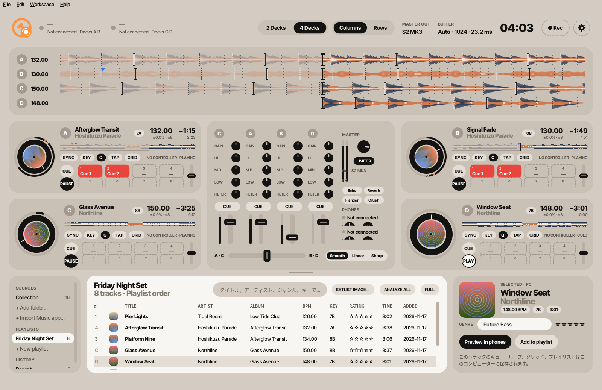
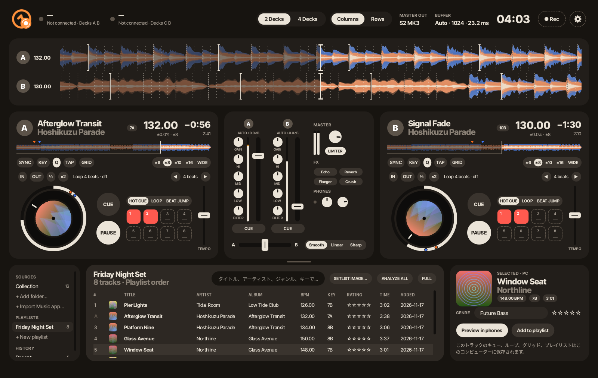

# moum deck

**違うDJコントローラー同士で、そのままB2Bできる DJ アプリ。**

Traktor のコントローラーと rekordbox のコントローラーのように、**違う機材を持ち寄って同じ画面でB2B**ができます。
1人2デッキ・合計4デッキ。ミキサーとヘッドホンは、それぞれ自分のコントローラーのものを使います。

- 無料・オフラインで動作（Windows 10 / 11。macOS は開発中）
- BPM・キーの自動解析、SYNC、ホットキュー、ループ、エフェクト
- 録音と、セットリスト入りのミックス映像の作成

**[⬇ 最新のインストーラー（Releases）](../../releases/latest)**　・　**[📖 画面と機能の説明](docs/guide.md)**

> **English:** A free, offline DJ app that lets two DJs play back-to-back with different controllers (e.g. Traktor Kontrol S2 MK3 + Pioneer DDJ-400) on one shared set of decks.

## 画面

| 4デッキ | ダークモード |
|---|---|
|  |  |

## 対応状況

| 使い方 | 状況 |
|---|---|
| コントローラー1台（Traktor Kontrol S2 MK3） | ✅ 使えます |
| コントローラー1台（Pioneer DDJ-400 / DDJ-FLX4） | 🧪 動作未確認 |
| 1台のPCに違うコントローラー2台でB2B | 🧪 動作未確認 |
| PC2台でB2B（Partner PC） | 🧪 動作未確認 |
| macOS | 🚧 開発中 |

## はじめかた

1. [Releases](../../releases/latest) からインストーラー（`moum_deck-x.x.x-Setup.exe`）をダウンロードして実行
2. 初回起動の「Setup guide」で、コントローラーと音の出力先を選ぶ
3. 「File › Scan folder…」で音楽フォルダを読み込む
4. 曲をダブルクリックしてデッキに載せる

対応形式は MP3 / WAV / AIFF / FLAC です。AAC（m4a）/ ALAC だけ ffmpeg が必要です。

画面の見かた、機能の一覧、設定、キーボード操作は [画面と機能の説明](docs/guide.md) にまとめています。

スクリーンショットは v2.2.0。写っている曲は撮影用のサンプルです。
