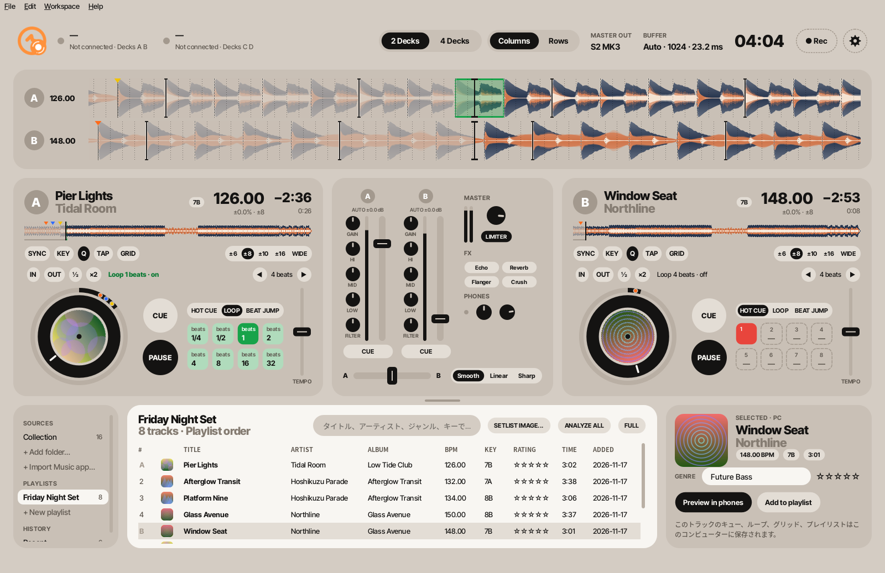
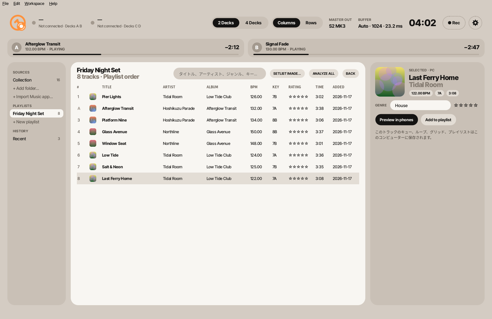
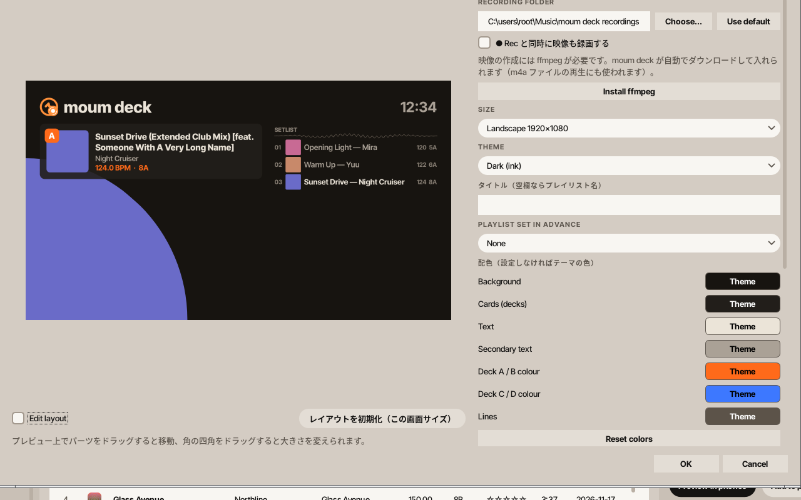
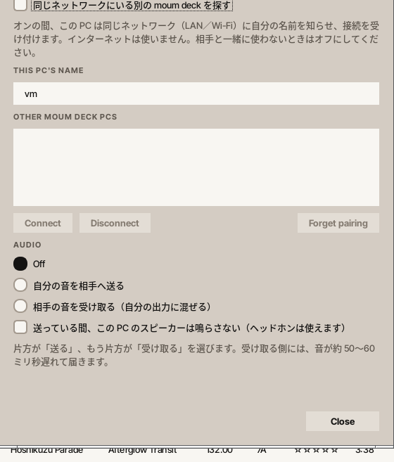
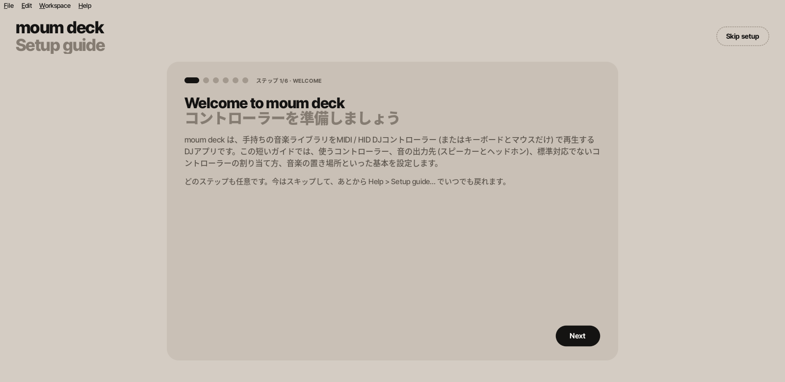
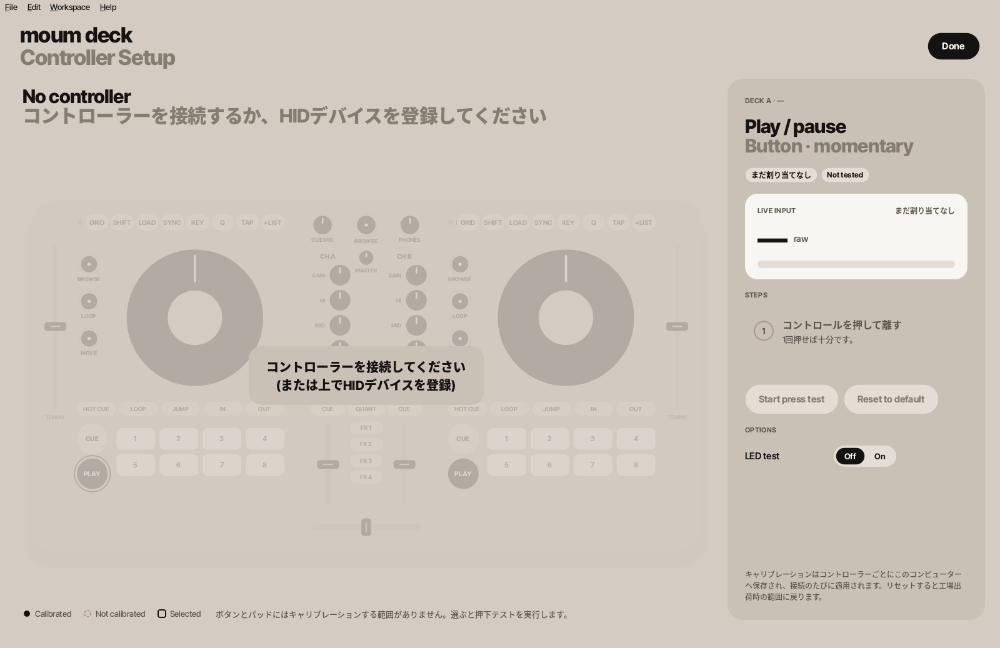

# moum deck

**違うDJコントローラー同士で、そのままB2Bできる DJ アプリ。**



Traktor のコントローラーを使う人と、rekordbox のコントローラーを使う人が一緒にプレイしようとすると、
これまではどちらかが機材やソフトを持ち替える必要がありました。
moum deck なら、**それぞれが自分のコントローラーを持ち寄るだけ**で、同じ画面の上でB2Bができます。

- 無料・オフラインで動きます（インターネットを使うのは、アップデートの確認だけです）
- Windows 10 / 11 対応。macOS は開発中です
- **[最新のインストーラーをダウンロード（Releases）](../../releases/latest)**

> **English:** moum deck is a free, fully offline DJ app that lets two DJs play back-to-back with **different controllers** — e.g. a Traktor Kontrol S2 MK3 and a Pioneer DDJ-400 — on one shared set of decks. Windows is supported now; macOS is in progress.

---

## 🎧 B2Bのしくみ

```
  あなた                              相手
  Traktor Kontrol S2 MK3              Pioneer DDJ-400
  （デッキ A・B を担当）                （デッキ C・D を担当）
          \                          /
           \                        /
            +---- moum deck（PC）----+
                      |
                  マスター出力 → スピーカー
```

- **1人2デッキ、合計4デッキ**で同時にプレイできます
- 各コントローラーのミキサーは、**自分の2デッキだけ**に効きます
- ヘッドホンは**それぞれ自分のコントローラーの端子**でモニターします
- インターネットは不要です


---

## 📋 いまの対応状況

| 使い方 | 状況 |
|---|---|
| 1人で、コントローラー1台を使う（Traktor Kontrol S2 MK3） | ✅ 使えます |
| 1人で、コントローラー1台を使う（Pioneer DDJ-400 / DDJ-FLX4） | 🧪 動作未確認 |
| 1台のPCに、違うコントローラー2台をつないでB2B | 🧪 動作未確認 |
| PC2台をつないでB2B（Partner PC。LANケーブル / Wi-Fi、インターネット不要） | 🧪 動作未確認 |
| その他の MIDI / HID コントローラー（自分で割り当て） | 🧪 動作未確認 |
| macOS | 🚧 開発中 |

✅ 使えます　🧪 機能はあるが検証中　🚧 開発中

動作確認できた組み合わせは、このREADMEで順次お知らせします。

---

## 🖥️ 画面の見かた

画面は上から **ヘッダー → 波形 → デッキとミキサー → ライブラリ** の順に並んでいます。

| 場所 | できること |
|---|---|
| ヘッダー | コントローラーの接続状態、デッキ数（2 / 4）とレイアウト（Columns / Rows）の切り替え、出力先、録音（● Rec）、設定（歯車ボタン） |
| 波形 | 全デッキの拡大波形を縦に並べて表示。拍の位置を見比べられます |
| デッキ | 曲名・BPM・キー、SYNC、ホットキュー、ループ、ビートジャンプ、テンポ |
| ミキサー | ゲイン、3バンドEQ、フィルター、フェーダー、クロスフェーダー、エフェクト |
| ライブラリ | 取り込み元・プレイリスト・再生履歴、曲の一覧、選んだ曲の詳細 |

### 波形とループ

低域・中域・高域を色分けした波形です。ループ中の範囲は緑で表示されます。


### レイアウトとテーマ

1デッキを横1行に並べる **Rows** レイアウトと、暗い場所向けの**ダークモード**（`Ctrl` + `Shift` + `D`）があります。

| Rows レイアウト（4デッキ） | ダークモード |
|---|---|
|  |  |

### ライブラリを大きく表示（Library view）

`Ctrl` + `L` で、ライブラリを画面いっぱいに広げられます。再生は止まりません。`Esc` で戻ります。



---

## ✨ 主な機能

**デッキ**
- 2デッキ / 4デッキの切り替え（Columns・Rows の2レイアウト）
- BPM・キーの自動解析、ビートグリッドの編集、SYNC（倍テン・半テン対応）
- キーロック、テンポレンジ（±6 / ±8 / ±10 / ±16 / WIDE）、クオンタイズ
- ホットキュー8個（色と名前を変更可）、ループ、ビートジャンプ

**ミキサー**
- 3バンドEQ、フィルター、ゲイン、マスターのリミッター
- ミキサーエフェクト（Echo / Reverb / Flanger / Crush）

**波形**
- 音域ごとに色分けした波形
- 1〜128拍まで拡大・縮小

**ライブラリ**
- フォルダの読み込み、iTunes／ミュージックアプリのライブラリ読み込み
- USBメモリの自動認識（キュー・ループ・プレイリストはUSBメモリに保存され、別のPCでも引き継げます）
- プレイリスト、再生履歴、検索
- BPMとキーをバックグラウンドで一括解析
- 音楽プレイヤー [moum player](https://github.com/mome0311/moum_player) で直した曲名やアーティストが、自動で反映されます

**録音とミックス映像**
- マスター出力をWAVで録音（ヘッダーの ● Rec）
- 録音と同時に、ミックス専用の映像（.mp4）を作成。流れている曲のジャケット・曲名・BPM・キー・セットリストが入ります
- 映像のサイズ（横長・縦長・正方形）、配色、レイアウトを変更可。映像の作成には ffmpeg が必要です（設定画面からインストールできます）



**セットリスト画像の書き出し**
- プレイリストを、SNS用の画像（正方形・縦長・ストーリーズ）として書き出し


**PC2台でのB2B（Partner PC）** 🧪 動作未確認
- 同じネットワークにあるもう1台の moum deck とつなぎ、相手のデッキで流れている曲を自分の画面で見られます
- 片方のPCの音をもう片方へ送り、1つの出力にまとめられます
- 2台の実機での動作は、まだ確認していません。本番では使わず、試すときは有線LANをおすすめします



**そのほか**
- ダークモード、日本語の説明表示、画面サイズの変更（70〜125%）
- キーボードとマウスだけでも操作可能
- 起動時に新しいバージョンを確認し、ボタン1つでアップデート

---

## 🚀 はじめかた（Windows）

1. **インストール**
   [Releases](../../releases/latest) ページから最新のインストーラー（`moum_deck-x.x.x-Setup.exe`）をダウンロードして実行します。
2. **初回セットアップ**
   起動すると「Setup guide」が開きます。案内に沿って、コントローラーと音声の出力先を選びます。
   あとから変えたいときは「Help › Setup guide…」で開き直せます。

   

3. **曲を読み込む**
   「File › Scan folder…」で音楽フォルダを選ぶか、iTunes のライブラリを読み込みます。
   読み込んだあと、ライブラリ右上の「ANALYZE ALL」でBPMとキーをまとめて解析できます。
4. **曲をデッキに載せる**
   曲をダブルクリックするとデッキAに載ります。ほかのデッキには、ドラッグ＆ドロップか、右クリックの「Load to deck …」で載せます。

### 設定を変える

右上の歯車ボタンから、設定の各ページを開けます。

| ページ | 内容 |
|---|---|
| Audio & controllers | 音の出力先、バッファ、コントローラーと担当デッキ、録音の保存先 |
| Library | 曲の取り込み元（フォルダ・iTunes・USB）の追加と再読み込み |
| Appearance | テーマ、言語、画面サイズ、パッドの色、アップデートの確認 |


対応機種以外のコントローラーは、「Controller Setup」でボタンやノブを1つずつ割り当てられます。



---

## ⌨️ キーボード操作

| 操作 | デッキ A | デッキ B | デッキ C | デッキ D |
|:---:|:---:|:---:|:---:|:---:|
| 再生 / 一時停止 | `Q` | `W` | `E` | `R` |
| CUE | `A` | `S` | `D` | `F` |
| ホットキュー 1〜4 | `1`〜`4` | `5`〜`8` | - | - |

- 波形の拡大・縮小：`Ctrl` + `=` / `Ctrl` + `-`
- Library view の切り替え：`Ctrl` + `L`（`Esc` で戻る）
- ダークモードの切り替え：`Ctrl` + `Shift` + `D`
- キーの割り当ては「Edit › Key Config…」で変更できます

---

## 💻 動作環境

| 項目 | 内容 |
|---|---|
| OS | Windows 10 / 11<br>macOS は開発中 |
| 音声ファイル | MP3 / WAV / AIFF / FLAC<br>AAC（m4a）/ ALAC は、別途 [ffmpeg](https://ffmpeg.org/) のインストールが必要です |
| 音声の出力先 | コントローラー内蔵のオーディオ、各種オーディオインターフェース |
| インターネット | 不要（アップデートの確認だけ GitHub に接続します。オフにもできます） |

設定とライブラリは `%APPDATA%\moum_deck\` に保存され、アップデートやアンインストールでは消えません。
問題が起きたときは、`%APPDATA%\moum_deck\logs\moum_deck.log` を確認できます（人に見せるときは、ユーザー名などを伏せてください）。

---

## 🗺️ これからの予定

- DDJ-400 と、2台同時接続でのB2Bの動作確認
- PC2台でのB2B（Partner PC）の実機での動作確認
- macOS 対応（Apple Silicon / Intel）

---

<sub>スクリーンショットは v2.2.0 のものです。画面に写っている曲は、撮影用に作ったサンプルです。</sub>
