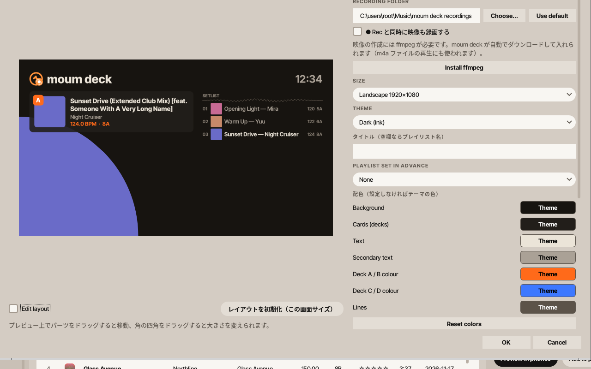
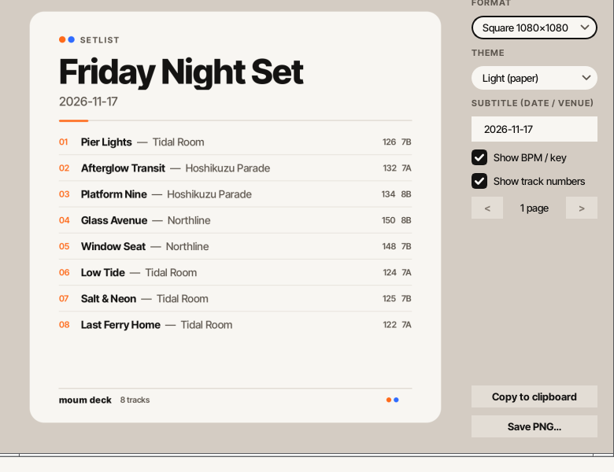
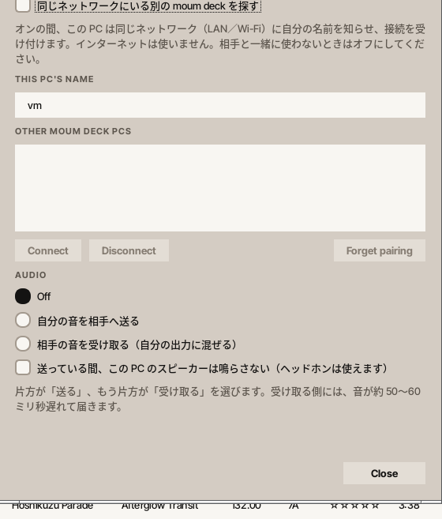

# moum deck — 機能

[🏠 ホーム](../README.md) ｜ **✨ 機能** ｜ [🖥️ 画面の見かた](screen.md) ｜ [⚙️ 設定と操作](settings.md)

---

## ✨ 主な機能

**デッキ**
- 2デッキ / 4デッキの切り替え（Columns・Rows の2レイアウト）
- BPM・キーの自動解析、ビートグリッドの編集、SYNC（倍テン・半テン対応）
- キーロック、テンポレンジ（±6 / ±8 / ±10 / ±16 / WIDE）、クオンタイズ
- ホットキュー8個（色と名前を変更可）、ループ、ビートジャンプ

**ミキサー**
- 3バンドEQ、フィルター、ゲイン、マスターのリミッター
- ミキサーエフェクト（Echo / Reverb / Flanger / Crush）

**波形**
- 音域ごとに色分けした波形
- 1〜128拍まで拡大・縮小

**ライブラリ**
- フォルダの読み込み、iTunes／ミュージックアプリのライブラリ読み込み
- USBメモリの自動認識（キュー・ループ・プレイリストはUSBメモリに保存され、別のPCでも引き継げます）
- プレイリスト、再生履歴、検索
- BPMとキーをバックグラウンドで一括解析
- 音楽プレイヤー [moum player](https://github.com/mome0311/moum_player) で直した曲名やアーティストが、自動で反映されます

**録音とミックス映像**
- マスター出力をWAVで録音（ヘッダーの ● Rec）
- 録音と同時に、ミックス専用の映像（.mp4）を作成。流れている曲のジャケット・曲名・BPM・キー・セットリストが入ります
- 映像のサイズ（横長・縦長・正方形）、配色、レイアウトを変更可。映像の作成には ffmpeg が必要です（設定画面からインストールできます）

**セットリスト画像の書き出し**
- プレイリストを、SNS用の画像（正方形・縦長・ストーリーズ）として書き出し

**PC2台でのB2B（Partner PC）** 🧪 動作未確認
- 同じネットワークにあるもう1台の moum deck とつなぎ、相手のデッキで流れている曲を自分の画面で見られます
- 片方のPCの音をもう片方へ送り、1つの出力にまとめられます
- 2台の実機での動作は、まだ確認していません。本番では使わず、試すときは有線LANをおすすめします

**そのほか**
- ダークモード、日本語の説明表示、画面サイズの変更（70〜125%）
- キーボードとマウスだけでも操作可能
- 起動時に新しいバージョンを確認し、ボタン1つでアップデート
