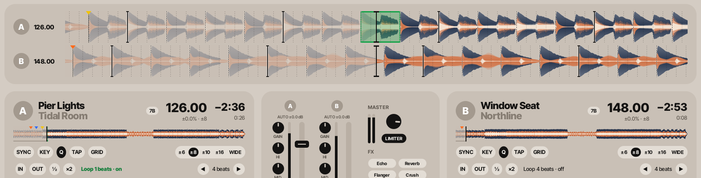
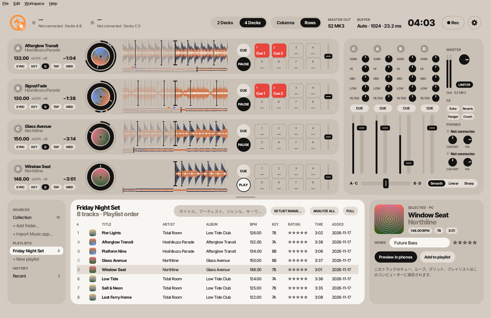
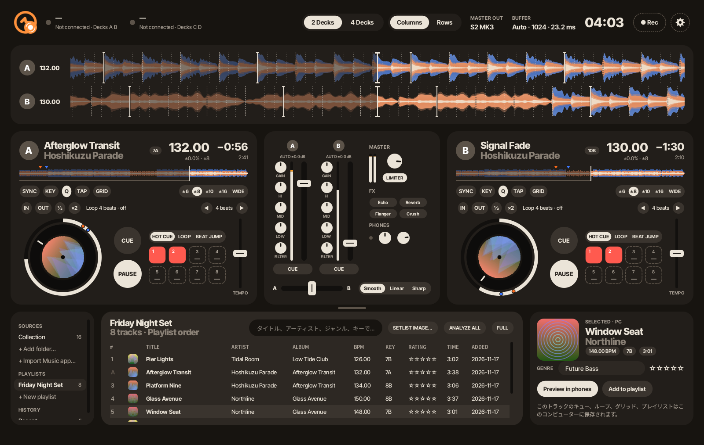
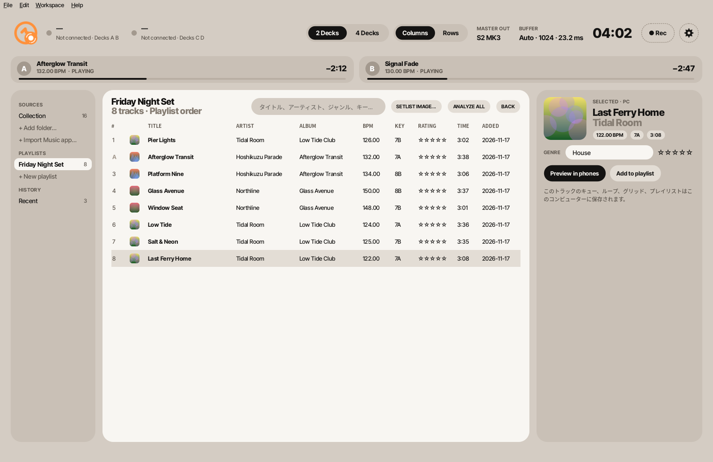
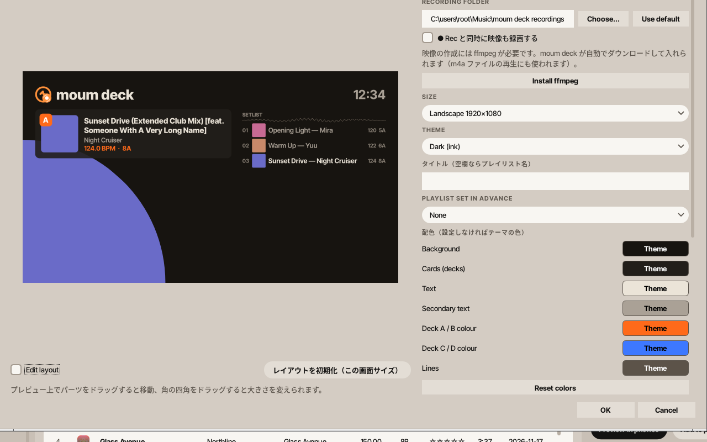
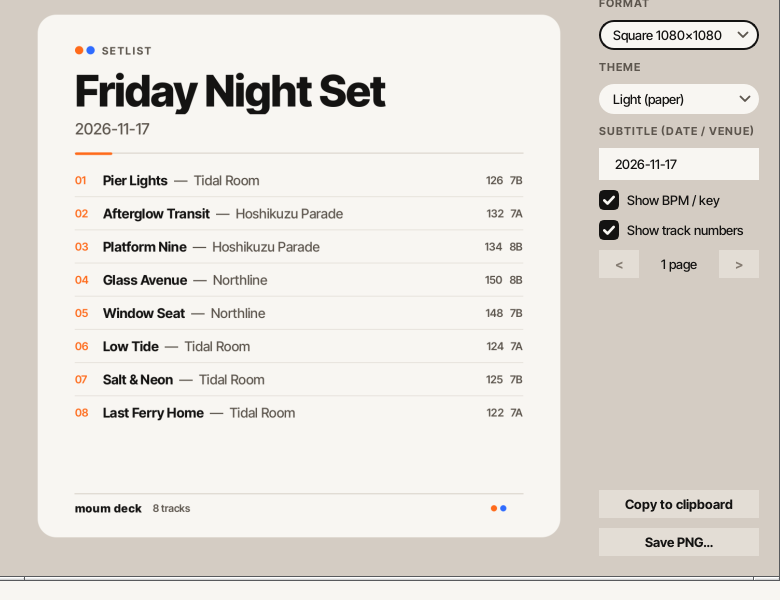
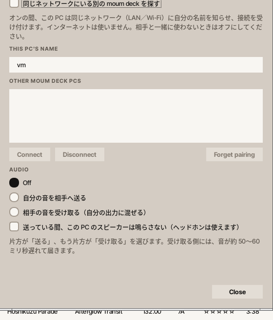
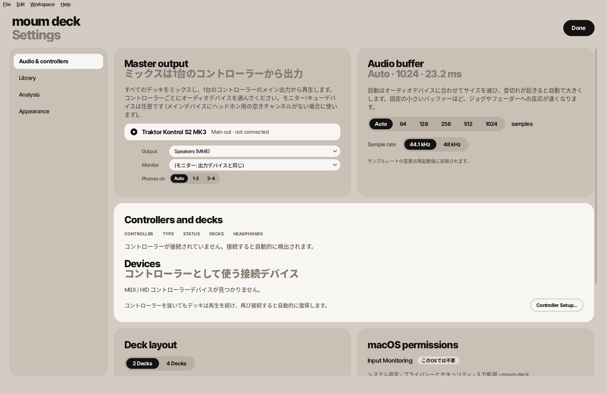
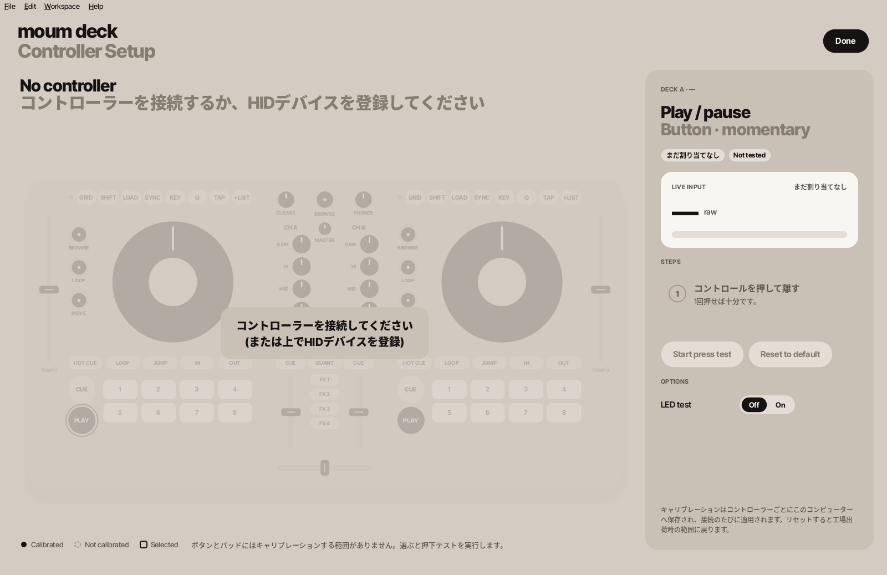

# moum deck 画面と機能の説明

[← README に戻る](../README.md)

## 🖥️ 画面の見かた

画面は上から **ヘッダー → 波形 → デッキとミキサー → ライブラリ** の順に並んでいます。

| 場所 | できること |
|---|---|
| ヘッダー | コントローラーの接続状態、デッキ数（2 / 4）とレイアウト（Columns / Rows）の切り替え、出力先、録音（● Rec）、設定（歯車ボタン） |
| 波形 | 全デッキの拡大波形を縦に並べて表示。拍の位置を見比べられます |
| デッキ | 曲名・BPM・キー、SYNC、ホットキュー、ループ、ビートジャンプ、テンポ |
| ミキサー | ゲイン、3バンドEQ、フィルター、フェーダー、クロスフェーダー、エフェクト |
| ライブラリ | 取り込み元・プレイリスト・再生履歴、曲の一覧、選んだ曲の詳細 |

### 波形とループ

低域・中域・高域を色分けした波形です。ループ中の範囲は緑で表示されます。

### レイアウトとテーマ

1デッキを横1行に並べる **Rows** レイアウトと、暗い場所向けの**ダークモード**（`Ctrl` + `Shift` + `D`）があります。

| Rows レイアウト（4デッキ） | ダークモード |
|---|---|
|  |  |

### ライブラリを大きく表示（Library view）

`Ctrl` + `L` で、ライブラリを画面いっぱいに広げられます。再生は止まりません。`Esc` で戻ります。

---

## ✨ 主な機能

**デッキ**
- 2デッキ / 4デッキの切り替え（Columns・Rows の2レイアウト）
- BPM・キーの自動解析、ビートグリッドの編集、SYNC（倍テン・半テン対応）
- キーロック、テンポレンジ（±6 / ±8 / ±10 / ±16 / WIDE）、クオンタイズ
- ホットキュー8個（色と名前を変更可）、ループ、ビートジャンプ

**ミキサー**
- 3バンドEQ、フィルター、ゲイン、マスターのリミッター
- ミキサーエフェクト（Echo / Reverb / Flanger / Crush）

**波形**
- 音域ごとに色分けした波形
- 1〜128拍まで拡大・縮小

**ライブラリ**
- フォルダの読み込み、iTunes／ミュージックアプリのライブラリ読み込み
- USBメモリの自動認識（キュー・ループ・プレイリストはUSBメモリに保存され、別のPCでも引き継げます）
- プレイリスト、再生履歴、検索
- BPMとキーをバックグラウンドで一括解析
- 音楽プレイヤー [moum player](https://github.com/mome0311/moum_player) で直した曲名やアーティストが、自動で反映されます

**録音とミックス映像**
- マスター出力をWAVで録音（ヘッダーの ● Rec）
- 録音と同時に、ミックス専用の映像（.mp4）を作成。流れている曲のジャケット・曲名・BPM・キー・セットリストが入ります
- 映像のサイズ（横長・縦長・正方形）、配色、レイアウトを変更可。映像の作成には ffmpeg が必要です（設定画面からインストールできます）

**セットリスト画像の書き出し**
- プレイリストを、SNS用の画像（正方形・縦長・ストーリーズ）として書き出し

**PC2台でのB2B（Partner PC）** 🧪 動作未確認
- 同じネットワークにあるもう1台の moum deck とつなぎ、相手のデッキで流れている曲を自分の画面で見られます
- 片方のPCの音をもう片方へ送り、1つの出力にまとめられます
- 2台の実機での動作は、まだ確認していません。本番では使わず、試すときは有線LANをおすすめします

**そのほか**
- ダークモード、日本語の説明表示、画面サイズの変更（70〜125%）
- キーボードとマウスだけでも操作可能
- 起動時に新しいバージョンを確認し、ボタン1つでアップデート

---

## ⚙️ 設定

右上の歯車ボタンから、設定の各ページを開けます。

| ページ | 内容 |
|---|---|
| Audio & controllers | 音の出力先、バッファ、コントローラーと担当デッキ、録音の保存先 |
| Library | 曲の取り込み元（フォルダ・iTunes・USB）の追加と再読み込み |
| Appearance | テーマ、言語、画面サイズ、パッドの色、アップデートの確認 |

対応機種以外のコントローラーは、「Controller Setup」でボタンやノブを1つずつ割り当てられます。

---

## ⌨️ キーボード操作

| 操作 | デッキ A | デッキ B | デッキ C | デッキ D |
|:---:|:---:|:---:|:---:|:---:|
| 再生 / 一時停止 | `Q` | `W` | `E` | `R` |
| CUE | `A` | `S` | `D` | `F` |
| ホットキュー 1〜4 | `1`〜`4` | `5`〜`8` | - | - |

- 波形の拡大・縮小：`Ctrl` + `=` / `Ctrl` + `-`
- Library view の切り替え：`Ctrl` + `L`（`Esc` で戻る）
- ダークモードの切り替え：`Ctrl` + `Shift` + `D`
- キーの割り当ては「Edit › Key Config…」で変更できます

---

## 💻 動作環境

| 項目 | 内容 |
|---|---|
| OS | Windows 10 / 11 macOS は開発中 |
| 音声ファイル | MP3 / WAV / AIFF / FLAC AAC（m4a）/ ALAC は、別途 [ffmpeg](https://ffmpeg.org/) のインストールが必要です |
| 音声の出力先 | コントローラー内蔵のオーディオ、各種オーディオインターフェース |
| インターネット | 不要（アップデートの確認だけ GitHub に接続します。オフにもできます） |

設定とライブラリは `%APPDATA%\moum_deck\` に保存され、アップデートやアンインストールでは消えません。
問題が起きたときは、`%APPDATA%\moum_deck\logs\moum_deck.log` を確認できます（人に見せるときは、ユーザー名などを伏せてください）。
