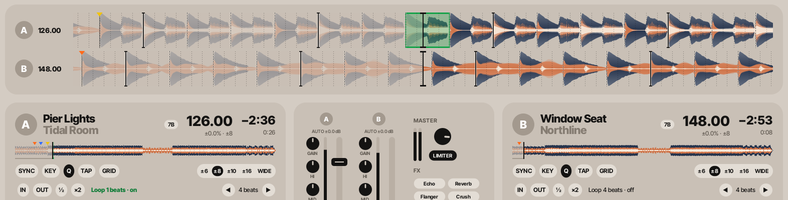
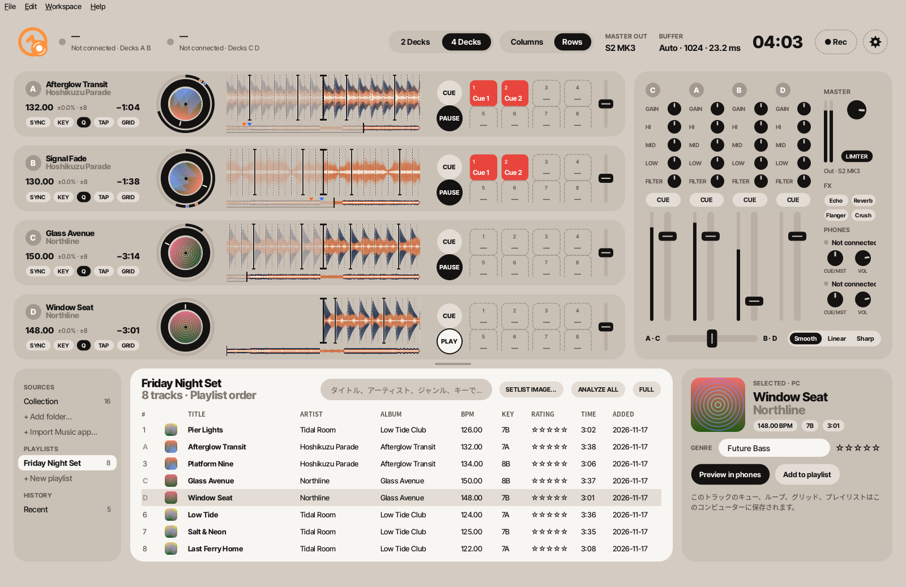
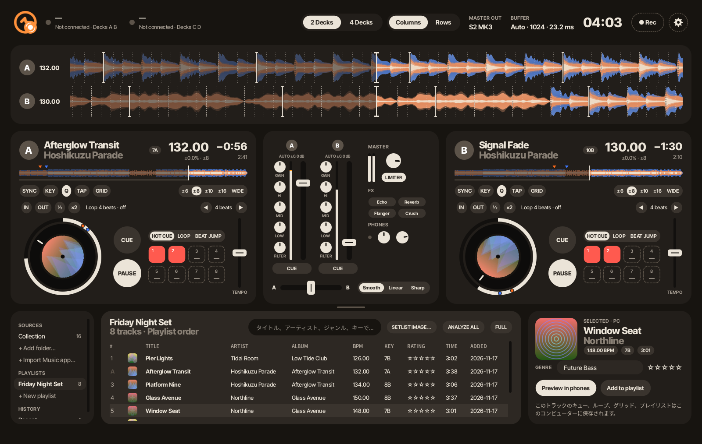
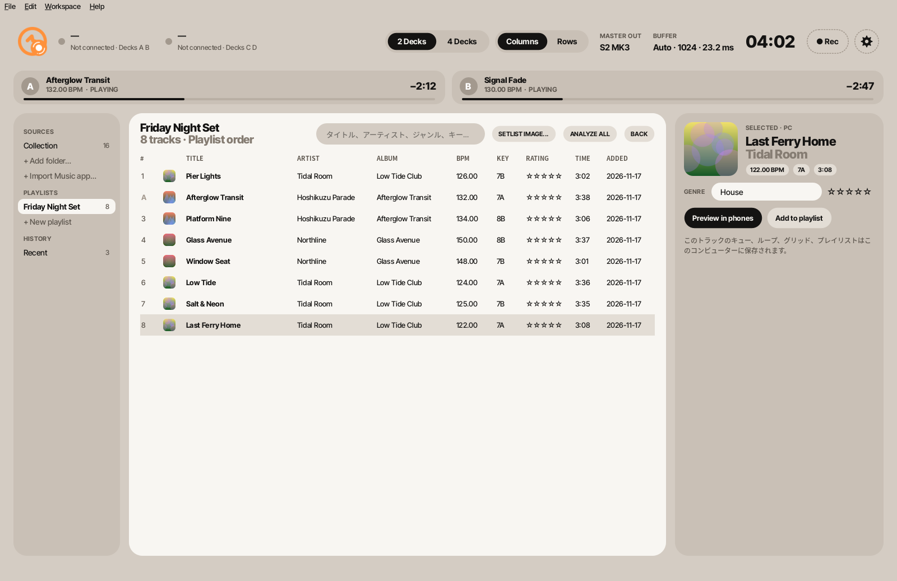

# moum deck — 画面の見かた

[🏠 ホーム](../README.md) ｜ [✨ 機能](features.md) ｜ **🖥️ 画面の見かた** ｜ [⚙️ 設定と操作](settings.md)

---

## 🖥️ 画面の見かた

画面は上から **ヘッダー → 波形 → デッキとミキサー → ライブラリ** の順に並んでいます。

| 場所 | できること |
|---|---|
| ヘッダー | コントローラーの接続状態、デッキ数（2 / 4）とレイアウト（Columns / Rows）の切り替え、出力先、録音（● Rec）、設定（歯車ボタン） |
| 波形 | 全デッキの拡大波形を縦に並べて表示。拍の位置を見比べられます |
| デッキ | 曲名・BPM・キー、SYNC、ホットキュー、ループ、ビートジャンプ、テンポ |
| ミキサー | ゲイン、3バンドEQ、フィルター、フェーダー、クロスフェーダー、エフェクト |
| ライブラリ | 取り込み元・プレイリスト・再生履歴、曲の一覧、選んだ曲の詳細 |

### 波形とループ

低域・中域・高域を色分けした波形です。ループ中の範囲は緑で表示されます。

### レイアウトとテーマ

1デッキを横1行に並べる **Rows** レイアウトと、暗い場所向けの**ダークモード**（`Ctrl` + `Shift` + `D`）があります。

| Rows レイアウト（4デッキ） | ダークモード |
|---|---|
|  |  |

### ライブラリを大きく表示（Library view）

`Ctrl` + `L` で、ライブラリを画面いっぱいに広げられます。再生は止まりません。`Esc` で戻ります。

