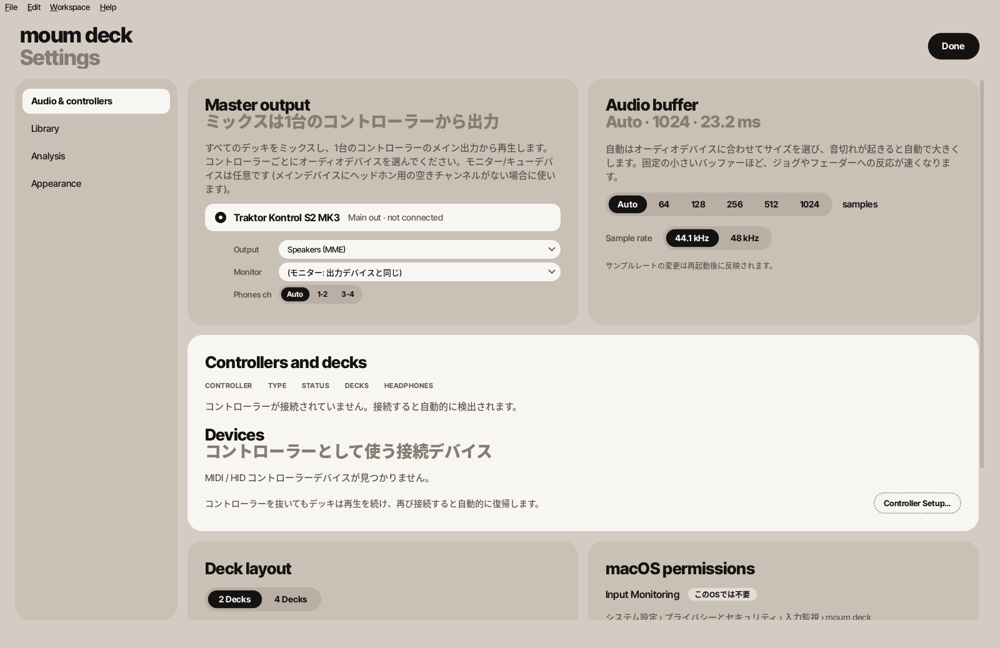
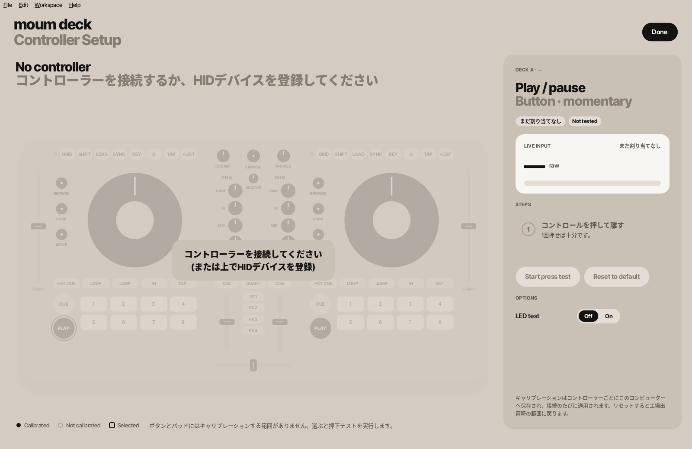

# moum deck — 設定と操作

[🏠 ホーム](../README.md) ｜ [✨ 機能](features.md) ｜ [🖥️ 画面の見かた](screen.md) ｜ **⚙️ 設定と操作**

---

## ⚙️ 設定

右上の歯車ボタンから、設定の各ページを開けます。

| ページ | 内容 |
|---|---|
| Audio & controllers | 音の出力先、バッファ、コントローラーと担当デッキ、録音の保存先 |
| Library | 曲の取り込み元（フォルダ・iTunes・USB）の追加と再読み込み |
| Appearance | テーマ、言語、画面サイズ、パッドの色、アップデートの確認 |

対応機種以外のコントローラーは、「Controller Setup」でボタンやノブを1つずつ割り当てられます。

---

## ⌨️ キーボード操作

| 操作 | デッキ A | デッキ B | デッキ C | デッキ D |
|:---:|:---:|:---:|:---:|:---:|
| 再生 / 一時停止 | `Q` | `W` | `E` | `R` |
| CUE | `A` | `S` | `D` | `F` |
| ホットキュー 1〜4 | `1`〜`4` | `5`〜`8` | - | - |

- 波形の拡大・縮小：`Ctrl` + `=` / `Ctrl` + `-`
- Library view の切り替え：`Ctrl` + `L`（`Esc` で戻る）
- ダークモードの切り替え：`Ctrl` + `Shift` + `D`
- キーの割り当ては「Edit › Key Config…」で変更できます

---

## 💻 動作環境

| 項目 | 内容 |
|---|---|
| OS | Windows 10 / 11 macOS は開発中 |
| 音声ファイル | MP3 / WAV / AIFF / FLAC AAC（m4a）/ ALAC は、別途 [ffmpeg](https://ffmpeg.org/) のインストールが必要です |
| 音声の出力先 | コントローラー内蔵のオーディオ、各種オーディオインターフェース |
| インターネット | 不要（アップデートの確認だけ GitHub に接続します。オフにもできます） |

設定とライブラリは `%APPDATA%\moum_deck\` に保存され、アップデートやアンインストールでは消えません。
問題が起きたときは、`%APPDATA%\moum_deck\logs\moum_deck.log` を確認できます（人に見せるときは、ユーザー名などを伏せてください）。
